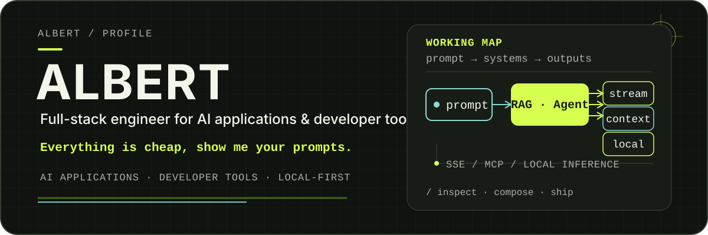

  <a href="./README.zh-CN.md">中文</a>

  <picture>
    <source media="(max-width: 560px) and (prefers-color-scheme: light)" srcset="./assets/readme/hero-mobile-light.svg">
    <source media="(max-width: 560px) and (prefers-color-scheme: dark)" srcset="./assets/readme/hero-mobile.svg">
    <source media="(prefers-color-scheme: light)" srcset="./assets/readme/hero-light.svg">
    <source media="(prefers-color-scheme: dark)" srcset="./assets/readme/hero.svg">
    
  </picture>

  <a href="https://albert-pzy.github.io/myself/">Resume</a>

  
  
  

### About

I am Albert, a full-stack engineer focused on AI applications and developer tools. I work mainly with TypeScript and Python.

### Current directions

- **AI application engineering** · RAG, Agent workflows, MCP, tool calling, local inference, and streamed responses
- **Product surfaces** · React and Next.js web interfaces, Electron desktop apps, and ProseMirror / CodeMirror editing systems
- **Runtime reliability** · cancellable requests, recoverable sessions, encrypted credentials, shared contracts, and observable task flows

### Stack

  <picture>
    <source media="(max-width: 560px) and (prefers-color-scheme: dark)" srcset="https://skillicons.dev/icons?i=ts%2Cpython%2Creact%2Cnextjs%2Cnodejs%2Celectron%2Cvite%2Ctailwind%2Csqlite%2Cgit%2Cgithubactions%2Clinux&amp;theme=dark&amp;perline=6">
    <source media="(max-width: 560px) and (prefers-color-scheme: light)" srcset="https://skillicons.dev/icons?i=ts%2Cpython%2Creact%2Cnextjs%2Cnodejs%2Celectron%2Cvite%2Ctailwind%2Csqlite%2Cgit%2Cgithubactions%2Clinux&amp;theme=light&amp;perline=6">
    <source media="(prefers-color-scheme: dark)" srcset="https://skillicons.dev/icons?i=ts%2Cpython%2Creact%2Cnextjs%2Cnodejs%2Celectron%2Cvite%2Ctailwind%2Csqlite%2Cgit%2Cgithubactions%2Clinux&amp;theme=dark&amp;perline=12">
    <source media="(prefers-color-scheme: light)" srcset="https://skillicons.dev/icons?i=ts%2Cpython%2Creact%2Cnextjs%2Cnodejs%2Celectron%2Cvite%2Ctailwind%2Csqlite%2Cgit%2Cgithubactions%2Clinux&amp;theme=light&amp;perline=12">
    
  </picture>

- **Languages** · TypeScript, JavaScript, and Python
- **Applications** · React, Next.js, Node.js, Electron, and Fastify
- **Data and tooling** · SQLite, GitHub Actions, Git, Linux, ProseMirror, and CodeMirror

### Live GitHub

  <picture>
    <source media="(max-width: 560px) and (prefers-color-scheme: dark)" srcset="https://github-profile-summary-cards.vercel.app/api/cards/most-commit-language?username=Albert-PZY&amp;theme=github_dark&amp;title_color=d7ff4f&amp;text_color=f3f5ea&amp;bg_color=10130f&amp;border_color=353d33&amp;icon_color=8ed8d2&amp;chart_color=b7dc43">
    <source media="(max-width: 560px) and (prefers-color-scheme: light)" srcset="https://github-profile-summary-cards.vercel.app/api/cards/most-commit-language?username=Albert-PZY&amp;theme=github&amp;title_color=466600&amp;text_color=172018&amp;bg_color=f7f8f2&amp;border_color=d9ded4&amp;icon_color=0c6664&amp;chart_color=669d65">
    <source media="(prefers-color-scheme: dark)" srcset="https://github-profile-summary-cards.vercel.app/api/cards/profile-details?username=Albert-PZY&amp;theme=github_dark&amp;title_color=d7ff4f&amp;text_color=f3f5ea&amp;bg_color=10130f&amp;border_color=353d33&amp;icon_color=8ed8d2&amp;chart_color=b7dc43">
    <source media="(prefers-color-scheme: light)" srcset="https://github-profile-summary-cards.vercel.app/api/cards/profile-details?username=Albert-PZY&amp;theme=github&amp;title_color=466600&amp;text_color=172018&amp;bg_color=f7f8f2&amp;border_color=d9ded4&amp;icon_color=0c6664&amp;chart_color=669d65">
    
  </picture>

  <picture>
    <source media="(prefers-color-scheme: dark)" srcset="https://github-profile-summary-cards.vercel.app/api/cards/stats?username=Albert-PZY&amp;theme=github_dark&amp;title_color=d7ff4f&amp;text_color=f3f5ea&amp;bg_color=10130f&amp;border_color=353d33&amp;icon_color=8ed8d2&amp;chart_color=b7dc43">
    <source media="(prefers-color-scheme: light)" srcset="https://github-profile-summary-cards.vercel.app/api/cards/stats?username=Albert-PZY&amp;theme=github&amp;title_color=466600&amp;text_color=172018&amp;bg_color=f7f8f2&amp;border_color=d9ded4&amp;icon_color=0c6664&amp;chart_color=669d65">
    
  </picture>
  <picture>
    <source media="(prefers-color-scheme: dark)" srcset="https://github-profile-summary-cards.vercel.app/api/cards/repos-per-language?username=Albert-PZY&amp;theme=github_dark&amp;title_color=d7ff4f&amp;text_color=f3f5ea&amp;bg_color=10130f&amp;border_color=353d33&amp;icon_color=8ed8d2&amp;chart_color=b7dc43">
    <source media="(prefers-color-scheme: light)" srcset="https://github-profile-summary-cards.vercel.app/api/cards/repos-per-language?username=Albert-PZY&amp;theme=github&amp;title_color=466600&amp;text_color=172018&amp;bg_color=f7f8f2&amp;border_color=d9ded4&amp;icon_color=0c6664&amp;chart_color=669d65">
    
  </picture>

  <picture>
    <source media="(prefers-color-scheme: dark)" srcset="https://streak-stats.demolab.com/?user=Albert-PZY&amp;hide_border=true&amp;background=10130F&amp;ring=D7FF4F&amp;fire=B7DC43&amp;currStreakLabel=D7FF4F&amp;sideLabels=A9B0A4&amp;dates=7F897D&amp;currStreakNum=F3F5EA&amp;sideNums=F3F5EA">
    <source media="(prefers-color-scheme: light)" srcset="https://streak-stats.demolab.com/?user=Albert-PZY&amp;hide_border=true&amp;background=F7F8F2&amp;ring=466600&amp;fire=669D65&amp;currStreakLabel=466600&amp;sideLabels=566257&amp;dates=6B756B&amp;currStreakNum=172018&amp;sideNums=172018">
    
  </picture>

  Rendered from public GitHub data. Providers may cache responses briefly.

### Contact

The best public place to reach me is [GitHub](https://github.com/Albert-PZY). For background and other contact details, see the [online resume](https://albert-pzy.github.io/myself/).
