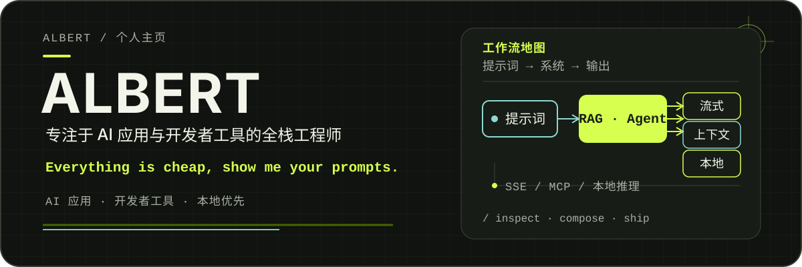

  <a href="./README.md">English</a>

  <picture>
    <source media="(max-width: 560px) and (prefers-color-scheme: light)" srcset="./assets/readme/hero-mobile-light-zh.svg">
    <source media="(max-width: 560px) and (prefers-color-scheme: dark)" srcset="./assets/readme/hero-mobile-zh.svg">
    <source media="(prefers-color-scheme: light)" srcset="./assets/readme/hero-light-zh.svg">
    <source media="(prefers-color-scheme: dark)" srcset="./assets/readme/hero-zh.svg">
    
  </picture>

  <a href="https://albert-pzy.github.io/myself/">在线简历</a>
  &nbsp;&nbsp;·&nbsp;&nbsp;
  <a href="https://github.com/Albert-PZY?tab=repositories">全部仓库</a>
  &nbsp;&nbsp;·&nbsp;&nbsp;
  <a href="https://albert-pzy.github.io/learn-pi-agent/">Pi Agent 教程</a>

  
  
  

### 关于

我是 Albert，一名专注于 AI 应用和开发者工具的全栈工程师。主要使用 TypeScript 和 Python，项目涵盖 Web 产品、Electron 桌面工作台、命令行工具和可运行的学习材料。

我的公开项目主要处理真实使用中出现的工程问题，包括流式连接生命周期、上下文恢复、检索质量、本地推理、类型契约和编辑器行为。下面每个项目都提供源码或可以直接访问的演示。

### 当前方向

- **AI 应用工程** · RAG、Agent 工作流、MCP、工具调用、本地推理和流式响应
- **产品界面** · React 和 Next.js Web 界面、Electron 桌面应用，以及 ProseMirror / CodeMirror 编辑系统
- **运行可靠性** · 可取消的请求、可恢复的会话、加密凭据、共享契约和可观测的任务流程

### 代表项目

**产品**

- **[typora-web](https://github.com/Albert-PZY/typora-web)** · 轻量、高保真的 Typora Web 移植版。 [在线演示](https://albert-pzy.github.io/typora-web/)
- **[VidGnost](https://github.com/Albert-PZY/VidGnost)** · 面向视频学习的本地优先 Electron 工作台，包含以字幕为基础的问答和可复现的学习产物。
- **[BiliSub](https://github.com/Albert-PZY/BiliSub)** · Bilibili AI 字幕工作台，支持流式获取、校对和导出。 [在线使用](https://bili-sub.vercel.app)

**系统与学习材料**

- **[codex-relay](https://github.com/Albert-PZY/codex-relay)** · Codex CLI 账号池管理器，在中转异常等情况下切换账号，并恢复中断会话的上下文。
- **[pi-retry-errors](https://github.com/Albert-PZY/pi-retry-errors)** · 由配置驱动的 Pi Coding Agent 异常自动重试扩展。
- **[motion-reel](https://github.com/Albert-PZY/motion-reel)** · 使用 Remotion、场景时间音频、字幕和 3D 动效生成程序化视频的 Codex skill。
- **[mcp-tutorial](https://github.com/Albert-PZY/mcp-tutorial)** · 可运行的 MCP 最小示例，覆盖 `stdio`、`SSE` 和 streamable HTTP 传输。 [在线教程](https://albert-pzy.github.io/mcp-tutorial/)
- **[learn-pi-agent](https://github.com/Albert-PZY/learn-pi-agent)** · 基于官方源码逐层拆解 Pi Agent 架构的学习指南。 [在线阅读](https://albert-pzy.github.io/learn-pi-agent/)

<b>更多仓库</b>

- **[CozyTag](https://github.com/Albert-PZY/CozyTag)** · 标签页导航实验。 [在线演示](https://albert-pzy.github.io/CozyTag/)
- **[LDSaver](https://github.com/Albert-PZY/LDSaver)** · 将 linux.do 帖子导出为 Markdown 的用户脚本。
- **[myself](https://github.com/Albert-PZY/myself)** · 在线个人介绍与简历的源码。

### 技术栈

  <picture>
    <source media="(max-width: 560px) and (prefers-color-scheme: dark)" srcset="https://skillicons.dev/icons?i=ts%2Cpython%2Creact%2Cnextjs%2Cnodejs%2Celectron%2Cvite%2Ctailwind%2Csqlite%2Cgit%2Cgithubactions%2Clinux&amp;theme=dark&amp;perline=6">
    <source media="(max-width: 560px) and (prefers-color-scheme: light)" srcset="https://skillicons.dev/icons?i=ts%2Cpython%2Creact%2Cnextjs%2Cnodejs%2Celectron%2Cvite%2Ctailwind%2Csqlite%2Cgit%2Cgithubactions%2Clinux&amp;theme=light&amp;perline=6">
    <source media="(prefers-color-scheme: dark)" srcset="https://skillicons.dev/icons?i=ts%2Cpython%2Creact%2Cnextjs%2Cnodejs%2Celectron%2Cvite%2Ctailwind%2Csqlite%2Cgit%2Cgithubactions%2Clinux&amp;theme=dark&amp;perline=12">
    <source media="(prefers-color-scheme: light)" srcset="https://skillicons.dev/icons?i=ts%2Cpython%2Creact%2Cnextjs%2Cnodejs%2Celectron%2Cvite%2Ctailwind%2Csqlite%2Cgit%2Cgithubactions%2Clinux&amp;theme=light&amp;perline=12">
    
  </picture>

- **语言** · TypeScript、JavaScript 和 Python
- **应用开发** · React、Next.js、Node.js、Electron 和 Fastify
- **数据与工具** · SQLite、GitHub Actions、Git、Linux、ProseMirror 和 CodeMirror

### 实时 GitHub 数据

  <picture>
    <source media="(max-width: 560px) and (prefers-color-scheme: dark)" srcset="https://github-profile-summary-cards.vercel.app/api/cards/most-commit-language?username=Albert-PZY&amp;theme=github_dark&amp;title_color=d7ff4f&amp;text_color=f3f5ea&amp;bg_color=10130f&amp;border_color=353d33&amp;icon_color=8ed8d2&amp;chart_color=b7dc43">
    <source media="(max-width: 560px) and (prefers-color-scheme: light)" srcset="https://github-profile-summary-cards.vercel.app/api/cards/most-commit-language?username=Albert-PZY&amp;theme=github&amp;title_color=466600&amp;text_color=172018&amp;bg_color=f7f8f2&amp;border_color=d9ded4&amp;icon_color=0c6664&amp;chart_color=669d65">
    <source media="(prefers-color-scheme: dark)" srcset="https://github-profile-summary-cards.vercel.app/api/cards/profile-details?username=Albert-PZY&amp;theme=github_dark&amp;title_color=d7ff4f&amp;text_color=f3f5ea&amp;bg_color=10130f&amp;border_color=353d33&amp;icon_color=8ed8d2&amp;chart_color=b7dc43">
    <source media="(prefers-color-scheme: light)" srcset="https://github-profile-summary-cards.vercel.app/api/cards/profile-details?username=Albert-PZY&amp;theme=github&amp;title_color=466600&amp;text_color=172018&amp;bg_color=f7f8f2&amp;border_color=d9ded4&amp;icon_color=0c6664&amp;chart_color=669d65">
    
  </picture>

  <picture>
    <source media="(prefers-color-scheme: dark)" srcset="https://github-profile-summary-cards.vercel.app/api/cards/stats?username=Albert-PZY&amp;theme=github_dark&amp;title_color=d7ff4f&amp;text_color=f3f5ea&amp;bg_color=10130f&amp;border_color=353d33&amp;icon_color=8ed8d2&amp;chart_color=b7dc43">
    <source media="(prefers-color-scheme: light)" srcset="https://github-profile-summary-cards.vercel.app/api/cards/stats?username=Albert-PZY&amp;theme=github&amp;title_color=466600&amp;text_color=172018&amp;bg_color=f7f8f2&amp;border_color=d9ded4&amp;icon_color=0c6664&amp;chart_color=669d65">
    
  </picture>
  <picture>
    <source media="(prefers-color-scheme: dark)" srcset="https://github-profile-summary-cards.vercel.app/api/cards/repos-per-language?username=Albert-PZY&amp;theme=github_dark&amp;title_color=d7ff4f&amp;text_color=f3f5ea&amp;bg_color=10130f&amp;border_color=353d33&amp;icon_color=8ed8d2&amp;chart_color=b7dc43">
    <source media="(prefers-color-scheme: light)" srcset="https://github-profile-summary-cards.vercel.app/api/cards/repos-per-language?username=Albert-PZY&amp;theme=github&amp;title_color=466600&amp;text_color=172018&amp;bg_color=f7f8f2&amp;border_color=d9ded4&amp;icon_color=0c6664&amp;chart_color=669d65">
    
  </picture>

  <picture>
    <source media="(prefers-color-scheme: dark)" srcset="https://streak-stats.demolab.com/?user=Albert-PZY&amp;hide_border=true&amp;background=10130F&amp;ring=D7FF4F&amp;fire=B7DC43&amp;currStreakLabel=D7FF4F&amp;sideLabels=A9B0A4&amp;dates=7F897D&amp;currStreakNum=F3F5EA&amp;sideNums=F3F5EA">
    <source media="(prefers-color-scheme: light)" srcset="https://streak-stats.demolab.com/?user=Albert-PZY&amp;hide_border=true&amp;background=F7F8F2&amp;ring=466600&amp;fire=669D65&amp;currStreakLabel=466600&amp;sideLabels=566257&amp;dates=6B756B&amp;currStreakNum=172018&amp;sideNums=172018">
    
  </picture>

  以上视图根据公开 GitHub 数据动态生成，服务提供方可能短暂缓存响应。

### 联系

可以通过 [GitHub](https://github.com/Albert-PZY) 与我公开联系。背景信息和其他联系方式请查看[在线简历](https://albert-pzy.github.io/myself/)。
